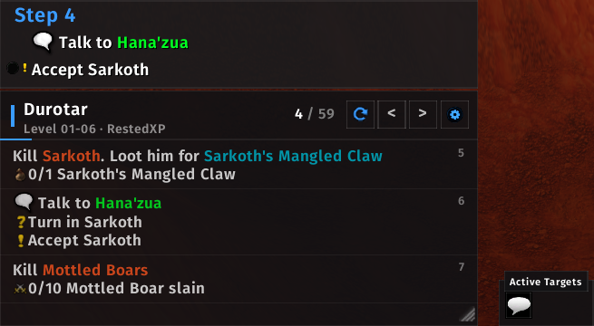
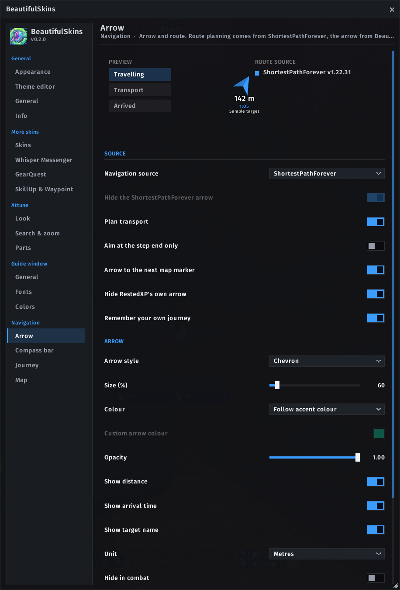
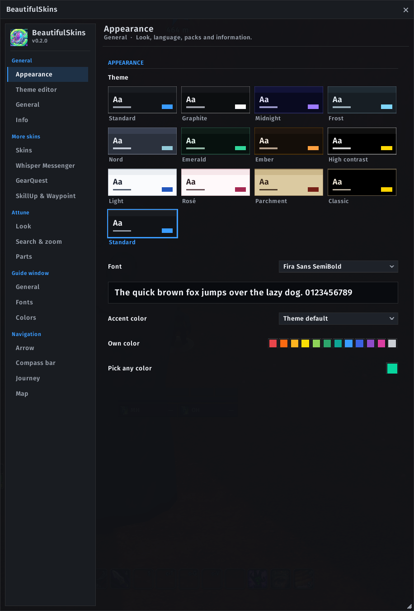

# BeautifulRestedXP

A skin for **World of Warcraft: Forever** (formerly *EUI RestedXP Skin*). It gives the RestedXP guide window a
modern, flat look and adds an arrow that points along the route planned by ShortestPathForever. With EllesmereUI it
follows EllesmereUI's accent colour and font live and its options sit in the EllesmereUI options window; without it
the addon brings its own options window, themes, fonts and accent colours.

> **Unofficial.** This addon is not affiliated with or endorsed by RestedXP or EllesmereUI.
> RestedXP is required, EllesmereUI is optional; both are installed separately. No code, graphics or fonts from either
> addon are included.

> **Also bundled in BeautifulSkins.** This RestedXP skin is part of **[BeautifulSkins](https://www.curseforge.com/wow/addons/beautifulskins)**,
> which brings the same look to Attune, GearQuest Forever, SkillUp Forever, Whisper Messenger and Waypoint UI as well.
> If you use more than just RestedXP, install BeautifulSkins instead: it contains everything in this addon, and with both
> installed BeautifulRestedXP steps back. BeautifulRestedXP (formerly EUI RestedXP Skin) stays here for everyone who only
> wants the RestedXP skin.

## Requirements

| Addon | Needed | Download |
|---|---|---|
| RestedXP Guides | required | [CurseForge](https://www.curseforge.com/wow/addons/restedxp-guide) |
| EllesmereUI | optional (look, accent and font follow it; options in its window) | [CurseForge](https://www.curseforge.com/wow/addons/ellesmereui) |
| ShortestPathForever | optional (route and transports for the arrow, Journey and compass skin) | [CurseForge](https://www.curseforge.com/wow/addons/shortest-path-forever) |

BeautifulRestedXP is the RestedXP part of **BeautifulSkins** (skins for Attune, RestedXP, GearQuest and more). If
you have BeautifulSkins installed, you do not need this addon; with both installed, BeautifulRestedXP steps back.
Settings of EUI RestedXP Skin are taken over on the first start. The package holds a small `EUI_RestedXP_Skin` folder that only carries them over; you may delete it afterwards.
Without ShortestPathForever the arrow points in a straight line to the step target.

## Features

- **Guide window** in the EllesmereUI style: header with step counter, progress bar and step buttons, current step
  with goals and counters, list of upcoming steps (the mouse wheel scrolls through the whole guide).
- **Colours:** follows the EllesmereUI accent colour; own accent, window and progress colours are optional;
  fonts from EllesmereUI or the game.
- **Item and target boxes** are pinned to an edge of the window. Drag a box to move it along the edge or to another
  edge; an accent line shows where it will dock. They stay usable in combat.
- **Navigation arrow** in four styles with distance, ETA and target name; states for travelling, transport
  (flight path, boat, zeppelin, lift, tram, portal, teleport) and arrival.
- **ShortestPathForever's Journey and compass** in the EllesmereUI look: the Journey section of the objective
  tracker matches the EllesmereUI quest tracker (accent header with a thin line, its fonts and colours, a dark
  panel behind it, the current step in the accent colour); the compass gets accent ticks, centre mark and
  walking marks, the EllesmereUI font and the window colour behind the band.
- **Target switch:** ShortestPathForever guides one journey at a time; one button, Shift-click on the arrow, key
  bindings or `/brxp target` go back and forth between the guide's target and your own journey.
- **Thirteen themes** with a gallery and a theme editor for your own themes (live contrast check, export and import).
- Optional: hide the window in combat and/or in instances, block RestedXP's guide window v2.
- English and German.

## Usage

All settings are in the options window of BeautifulRestedXP (or, with EllesmereUI, in its options window, section
**RestedXP**; switchable under General). Open them with `/brxp`, with a right-click on the cog in the guide header,
from the minimap button or from the addon compartment. Under General > Appearance you choose the theme (Midnight,
Frost, Light, Parchment ...), the font and the accent colour; the theme editor makes your own.

| Command | Effect |
|---|---|
| `/brxp` | open the options |
| `/brxp lock` / `unlock` | lock or unlock the arrow for dragging |
| `/brxp probe` | print diagnostic information for bug reports |
| `/brxp spf` | show whether the Journey and compass skin found ShortestPathForever's frames |

"Restyle RestedXP" off gives you RestedXP's own look back; "Reset to defaults" restores every value the skin
changed in RestedXP and ShortestPathForever.

## Installation

Install from CurseForge, or copy the folders `BeautifulRestedXP`, `BeautifulRestedXP_Skin` and `EUI_RestedXP_Skin` (settings transfer) into
`World of Warcraft/_forever_/Interface/AddOns/` (the folder names must stay exactly as they are).

## Support

Bug reports and ideas: [GitHub Issues](https://github.com/HeartOfD2/BeautifulRestedXP/issues). Please include the
output of `/brxp probe` and the full Lua error text.

## Licence

MIT, see [LICENSE](LICENSE). RestedXP, EllesmereUI and ShortestPathForever belong to their respective authors.
